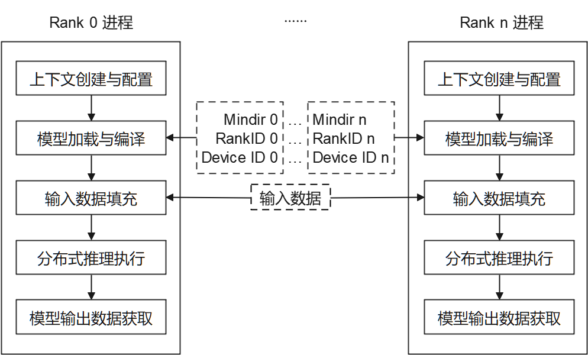

# 使用Python接口执行云侧分布式推理

[](https://atomgit.com/mindspore/docs/blob/master/docs/lite/cloud_docs/source_zh_cn/mindir/runtime_distributed_python.md)

## 概述

针对大规模神经网络模型参数多、无法完全加载至单设备推理的场景，可利用多设备进行分布式推理。本教程介绍如何使用[Python接口](https://www.mindspore.cn/lite/api/zh-CN/master/mindspore_lite.html)执行MindSpore Lite云侧分布式推理。云侧分布式推理与[云侧单卡推理](https://www.mindspore.cn/lite/cloud_docs/zh-CN/master/mindir/runtime_python.html)流程大致相同，可以相互参考。MindSpore Lite云侧分布式推理在性能方面有更多优化。

MindSpore Lite云侧分布式推理仅支持在Linux环境下部署运行，支持的设备类型为Atlas训练系列产品。如下图所示，当前通过多进程方式启动分布式推理，每个进程对应通信集合中的一个`Rank`，对各自已切分的模型进行加载、编译与执行，每个进程输入数据相同。



每个进程主要包括以下步骤：

1. 模型读取：通过MindSpore切分，并导出分布式MindIR模型，MindIR模型数量与设备数相同，用于加载到各个设备进行推理。
2. 上下文创建与配置：创建并配置上下文[Context](https://www.mindspore.cn/lite/api/zh-CN/master/mindspore_lite/mindspore_lite.Context.html#mindspore_lite.Context)，保存分布式推理参数，用于指导分布式模型编译和模型执行。
3. 模型加载与编译：使用[Model.build_from_file](https://www.mindspore.cn/lite/api/zh-CN/master/mindspore_lite/mindspore_lite.Model.html#mindspore_lite.Model.build_from_file)接口进行模型加载和模型编译。模型加载阶段将文件缓存解析成运行时的模型。模型编译阶段将前端计算图优化为高性能后端计算图，该过程耗时较长。建议一次编译，多次推理。
4. 模型输入数据填充。
5. 分布式推理执行：使用[Model.predict](https://www.mindspore.cn/lite/api/zh-CN/master/mindspore_lite/mindspore_lite.Model.html#mindspore_lite.Model.predict)接口进行模型分布式推理。
6. 模型输出数据获取。
7. 多进程执行分布式推理脚本。

## 准备工作

1. 下载云侧分布式推理python示例代码，请选择设备类型：[Ascend](https://atomgit.com/mindspore/mindspore-lite/tree/master/mindspore-lite/examples/cloud_infer/ascend_ge_distributed_python)。下文将该目录称为示例代码目录。

2. 通过MindSpore切分，并导出分布式MindIR模型，将其存放至示例代码目录。如需快速体验，可下载已切分的两个Matmul模型文件[Matmul0.mindir](https://download.mindspore.cn/model_zoo/official/lite/quick_start/Matmul0.mindir)、[Matmul1.mindir](https://download.mindspore.cn/model_zoo/official/lite/quick_start/Matmul1.mindir)。

3. 对于Ascend设备类型，通过hccl_tools.py根据需要生成组网信息文件，存放至示例代码目录，并将该文件路径填入示例代码目录下配置文件 `config_file.ini` 中。

4. 下载MindSpore Lite云侧推理安装包[mindspore-lite-{version}-linux-{arch}.whl](https://www.mindspore.cn/lite/docs/zh-CN/master/use/downloads.html)，存放至示例代码目录，并通过`pip`工具安装。

后续章节将结合代码讲述MindSpore Lite云侧分布式推理主要步骤，完整代码请参考示例代码目录下`main.py`。

## 创建上下文配置

上下文配置保存了所需基本配置参数与分布式推理参数，用于指导模型编译和模型分布式执行。如下示例代码演示如何通过[Context](https://www.mindspore.cn/lite/api/zh-CN/master/mindspore_lite/mindspore_lite.Context.html#mindspore_lite.Context)创建上下文。

```python
# init context
context = mslite.Context()
```

分布式推理场景下支持Ascend，可通过[Context.target](https://www.mindspore.cn/lite/api/zh-CN/master/mindspore_lite/mindspore_lite.Context.html#mindspore_lite.Context.target)指定运行的设备。

### 配置Ascend设备上下文

当设备类型为Ascend时（目前分布式推理支持Atlas训练系列产品），设置[Context.target](https://www.mindspore.cn/lite/api/zh-CN/master/mindspore_lite/mindspore_lite.Context.html#mindspore_lite.Context.target)为`Ascend`，并通过如下方式设置`DeviceID`、`RankID`。由于Ascend提供多个推理引擎后端，当前仅`ge`后端支持分布式推理，通过`ascend.provider`指定Ascend推理引擎后端为`ge`。示例代码如下：

```python
# set Ascend target and distributed info
context.target = ["Ascend"]
context.ascend.device_id = args.device_id
context.ascend.rank_id = args.rank_id
context.ascend.provider = "ge"
```

### 配置Ascend GE 编译缓存

GE 后端在模型编译阶段完成整图的算子编译，模型较大时该阶段耗时可达分钟级。MindSpore Lite 支持将整图编译结果缓存到指定目录：后续启动时若编译条件完全一致，则直接加载缓存产物、跳过在线编译，从而缩短模型加载与首次推理的等待时间。该能力仅对 `ascend.provider` 为 `ge` 的后端生效。

编译缓存通过 `Model.build_from_file` 的 `config_file` 参数配置，推荐在 `[ascend_context]` 段中设置 `model_cache_dir`：

```ini
[ascend_context]
model_cache_dir=/home/xxx/ge_compile_cache
```

分布式推理场景下请为每个 `Rank` 使用独立目录（例如 `/home/xxx/ge_compile_cache/rank{r}`），具体见下方使用约束。

也可以在 `[ge_session_options]` 段中直接设置 GE 原生选项 `ge.graph_compiler_cache_dir`，效果相同：

```ini
[ge_session_options]
ge.graph_compiler_cache_dir=/home/xxx/ge_compile_cache
```

两者同时配置时以 `[ascend_context]` 段的 `model_cache_dir` 为准。推荐使用 `model_cache_dir`：框架会对目录的存在性与可写性做校验，目录不可用时仅禁用缓存并打印 WARNING，不影响推理执行；而直接配置 `ge.graph_compiler_cache_dir` 且目录不存在时，GE 侧会因找不到缓存目录而报错（E13026）。

使用约束：

1. **缓存目录需预先创建且可写**。建议使用单独的空目录，不要与其他用途的目录混用。
2. **分布式推理时每个 `Rank` 必须使用独立的缓存目录**。缓存键中不包含 `Rank` 信息，多个 `Rank` 共用同一个目录会互相覆盖缓存产物，**不会报错，但可能得到错误的推理结果**。推荐把 `Rank` 号拼进目录路径，例如 `model_cache_dir=/home/xxx/ge_compile_cache/rank{r}`；也可以为每个 `Rank` 配置独立的 `ge.graph_key`（必须写在 `[ge_graph_options]` 段，写在 `[ge_session_options]` 会被框架生成的缓存键覆盖，不起作用）。若确认多个 `Rank` 的图完全相同（例如共用同一份前缀图），它们之间可以共用目录；其余情况请默认按 `Rank` 分开。
3. **需保证编译条件一致才会复用**：MindIR 图结构与算子属性、配置文件中影响编译的选项、SoC 型号需保持一致。条件变化时缓存会自动失效并回退到在线编译，不会复用其他条件下的产物，因此缓存失效的表现是"重新完整编译一次"，属预期行为。需要特别注意：CANN 版本不在缓存键中，升级或更换 CANN 后需要验证缓存是否生效，以及模型推理精度是否符合预期；同时建议不同的模型使用不同的缓存路径。
4. **缓存目录的路径本身不参与命中判定**，因此可以在构建环境完成一次预热后，把整个缓存目录拷贝到部署环境使用（前提是 SoC 与配置一致）。拷贝时请将缓存目录完整拷贝，缺少任意缓存文件都可能会导致缓存命中失败；分布式场景下应按 `Rank` 分别预热、分别分发对应目录。
5. **重装或更新自定义算子（算子 vendor 包）后需手工清理缓存目录**。算子实现内容不在命中判定条件内，若不清理缓存，可能复用按旧算子编译的产物。
6. **缓存键中不包含 MindSpore Lite 版本信息**：升级 MindSpore Lite 后，旧缓存仍可能被命中。若需要按新版本重建缓存（例如确认新版本的编译行为发生了变化），请在升级后手工清理缓存目录再重新预热。

**内存优化模式（`model_cache_mode=mem_opt`）**：除直接指定缓存目录外，还可以在 `[ascend_context]` 段打开内存优化模式：

```ini
[ascend_context]
model_cache_mode=mem_opt
model_cache_dir=/home/xxx/ge_compile_cache/rank{r}
```

- 配置 `model_cache_mode` 即启用图级编译缓存；未配置 `model_cache_dir` 时，默认在当前工作目录下创建 `./model_build_cache_<rank>`（已按 `Rank` 分目录）。若当前工作目录不可写，会自动禁用缓存并继续加载（日志打印 WARNING），不会导致加载失败；但 GE 编译过程可能仍需在当前目录生成临时文件，因此仍建议显式指定可写的 `model_cache_dir`。
- `mem_opt` 表示加载时用与该图同名的**最小占位图**代替完整图加入 GE 会话，执行时复用缓存目录中已编译好的产物，以降低会话内存占用。因此它**依赖已存在的完整缓存**：首次运行尚无缓存时仍按常规方式完整编译，缓存就绪后再次加载才会生效。
- 若缓存目录中缺少该图对应的索引（例如缓存被清理），框架会自动跳过该模式、按常规方式加载，功能不受影响，只是没有内存优化。
- 与普通缓存一致，多 `Rank` 必须使用独立目录（见使用约束第 2 条）；`mem_opt` 的默认目录同样按 `Rank` 分开。

缓存命中后，GE 的 INFO 级日志中会打印 `Cache is enable, cache_dir=..., graph_key=...`，且缓存目录下会出现 `.om`、`.rdcpkt`、`.idx` 等产物文件；对比再次启动时模型编译阶段的耗时可以直观确认命中效果。首次部署（缓存为空）仍需完整编译一次，生产环境建议在构建阶段使用相同版本与配置完成预热，再将缓存目录随部署制品分发，使生产环境首次启动即可命中。

此外，首次编译阶段还可以通过 `[ascend_context]` 段的 `TE_PARALLEL_COMPILER` 开启 TBE 算子并行编译（并行编译进程数，取值范围 1~32，默认 8），与编译缓存配合可进一步压缩部署等待时间。

## 模型创建、加载与编译

与[MindSpore Lite云侧单卡推理](https://www.mindspore.cn/lite/cloud_docs/zh-CN/master/mindir/runtime_python.html)一致，分布式推理的主入口是[Model](https://www.mindspore.cn/lite/api/zh-CN/master/mindspore_lite/mindspore_lite.Model.html#mindspore_lite.Model)接口，可进行模型加载、编译和执行。创建[Model](https://www.mindspore.cn/lite/api/zh-CN/master/mindspore_lite/mindspore_lite.Model.html#mindspore_lite.Model)并调用[Model.build_from_file](https://www.mindspore.cn/lite/api/zh-CN/master/mindspore_lite/mindspore_lite.Model.html#mindspore_lite.Model.build_from_file)接口来实现模型加载与模型编译，示例代码如下：

```python
# create Model and build Model
model = mslite.Model()
model.build_from_file(model_path, mslite.ModelType.MINDIR, context, config_file)
```

## 模型输入数据填充

首先，使用[Model.get_inputs](https://www.mindspore.cn/lite/api/zh-CN/master/mindspore_lite/mindspore_lite.Model.html#mindspore_lite.Model.get_inputs)方法获取所有输入[Tensor](https://www.mindspore.cn/lite/api/zh-CN/master/mindspore_lite/mindspore_lite.Tensor.html#mindspore_lite.Tensor)，利用相关接口将Host数据填入其中。示例代码如下：

```python
# set model input as ones
inputs = model.get_inputs()
for input_i in inputs:
    input_i.set_data_from_numpy(np.ones(input_i.shape, dtype=np.float32))
```

也可通过以下方式构造MindSpore Lite输入。

```python
# np_inputs is a list or tuple of numpy array
inputs = [mslite.Tensor(np_input) for np_input in np_inputs]
```

## 分布式推理执行

调用[Model.predict](https://www.mindspore.cn/lite/api/zh-CN/master/mindspore_lite/mindspore_lite.Model.html#mindspore_lite.Model.predict)接口执行分布式推理，示例代码如下：

```python
# execute inference
outputs = model.predict(inputs)
```

## 模型输出数据获取

模型输出数据保存在上一步定义的输出[Tensor](https://www.mindspore.cn/lite/api/zh-CN/master/mindspore_lite/mindspore_lite.Tensor.html#mindspore_lite.Tensor)中，通过相关接口可访问输出数据。如下示例代码展示了如何访问输出数据并打印。

```python
# get output and print
for output in outputs:
    name = output.name.rstrip()
    data_size = output.data_size
    element_num = output.element_num
    print("tensor's name is:%s data size is:%s tensor elements num is:%s" %
          (name, data_size, element_num))
    data = output.get_data_to_numpy()
    data = data.flatten()
    print("output data is:", end=" ")
    for i in range(10):
        print(data[i], end=" ")
    print("")
```

## 执行分布式推理样例

按以下多进程方式启动分布式推理。完整运行命令请参考示例代码目录下`run.sh`。运行成功后，将打印每个输出`Tensor`的名称、数据大小、元素个数与前10个元素值。

```bash
# for Ascend, run the executable file for each rank using shell commands
python3 ./ascend_ge_distributed.py --model_path=/your/path/to/Matmul0.mindir --device_id=0 --rank_id=0 --config_file=./config_file.ini &
python3 ./ascend_ge_distributed.py --model_path=/your/path/to/Matmul1.mindir --device_id=1 --rank_id=1 --config_file=./config_file.ini
```

## 多模型共享权重

Ascend设备图编译等级为O2的场景下，单个卡可以部署多个模型，部署到同一张卡的模型可以共享权重，详情可参考[高级用法-多模型共享权重](https://www.mindspore.cn/lite/cloud_docs/zh-CN/master/mindir/runtime_cpp.html#%E5%A4%9A%E6%A8%A1%E5%9E%8B%E5%85%B1%E4%BA%AB%E6%9D%83%E9%87%8D)。
