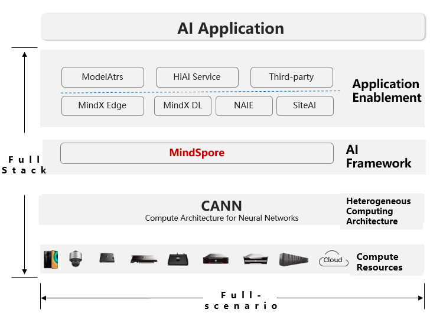

**Introduction** || [Quick Start](https://www.mindspore.cn/tutorials/en/master/beginner/quick_start.html) || [Tensor](https://www.mindspore.cn/tutorials/en/master/beginner/tensor.html) || [Data Loading and Processing](https://www.mindspore.cn/tutorials/en/master/beginner/dataset.html) || [Model](https://www.mindspore.cn/tutorials/en/master/beginner/model.html) || [Autograd](https://www.mindspore.cn/tutorials/en/master/beginner/autograd.html) || [Train](https://www.mindspore.cn/tutorials/en/master/beginner/train.html) || [Save and Load](https://www.mindspore.cn/tutorials/en/master/beginner/save_load.html) || [Accelerating with Static Graphs](https://www.mindspore.cn/tutorials/en/master/beginner/accelerate_with_static_graph.html)

# Overview

The following describes the Huawei AI full-stack solution and the position of MindSpore in the solution. Developers who are interested in MindSpore can visit the [MindSpore community](https://atomgit.com/mindspore/mindspore) and click [Watch, Star, and Fork](https://atomgit.com/mindspore/mindspore) on the repository.

## Introduction to MindSpore

### Overall Architecture

The overall architecture of MindSpore is as follows:

1. HyperParallel Parallel Library: Provides developers with out-of-the-box large model parallel training enablement. Delivers a minimal, decoupled experience between models and parallel optimization, and supports parallel enablement for HuggingFace model integration. Meanwhile, for Ascend super-node architecture, provides affinity-based parallel technologies such as HSDP.
2. MindSpore Core: Provides Ascend-affinity graph-computation fusion optimization and runtime acceleration technologies, supporting users in programming and execution with dynamic graph mode as well as static graph compilation acceleration. MindData provides data loading and data preprocessing capabilities.
3. MS Lite: Provides deployment for device-edge scenarios, supports lightweight model inference, and delivers a full-scenario deployment experience.
4. MindSpore Science: AI + Scientific Computing Suite, designed for AI4S scenarios, it provides out-of-the-box model kits for multiple domains such as electromagnetics and pharmaceuticals, making it easier for the scientific computing field to integrate AI into development and application.
5. MindSpore Transformers: Large Model Suite, provides developers with out-of-the-box mainstream large models and development kits.

### Design Philosophy

MindSpore is a full-scenario deep learning framework designed to achieve three major goals: easy development, efficient execution, and unified deployment across all scenarios.

- Easy development: API friendliness and low debugging difficulty.
- Efficient execution: computational efficiency, data preprocessing efficiency, and distributed training efficiency.
- Full-scenario: the framework simultaneously supports cloud, edge, and device-side scenarios.

## Introduction to Huawei Ascend AI Full-Stack Solution

Ascend computing is a full-stack AI computing infrastructure and application based on the Ascend series processors. It includes the Ascend series chips, Atlas series hardware, CANN chip enablement, MindSpore AI framework, ModelArts, and MindX application enablement.

The Huawei Atlas AI computing solution is based on the Ascend series AI processors. It uses various product forms such as modules, cards, edge stations, servers, and clusters to build a full-scenario AI infrastructure solution oriented toward device, edge, and cloud. It covers data center and intelligent edge solutions, as well as the entire inference and training processes in the deep learning field.

The Ascend AI full-stack is shown below:

The functions of each module are described as follows:

- **Ascend Application Enablement**: Huawei's major product lines provide AI platform or service capabilities based on MindSpore.
- **MindSpore**: A unified training and inference framework that supports independent and collaborative deployment across device, edge, and cloud.
- **CANN**: A driver layer that enables Ascend chips.
- **Compute Resources**: Ascend series IP, chips and servers.

For details, click [Huawei Ascend official website](https://e.huawei.com/en/products/servers/ascend).

## Joining the Community

We welcome every developer to the MindSpore community to contribute to this full-scenario AI framework.

- **MindSpore official website**: A comprehensive resource for MindSpore information, including installation, tutorials, documents, community, resources, and news ([learn more](https://www.mindspore.cn/en)).
- **MindSpore code**:

    - [MindSpore AtomGit](https://atomgit.com/mindspore/mindspore): You can track the latest progress of MindSpore by clicking Watch, Star, and Fork. You can also discuss issues and commit code.
    - [MindSpore GitHub](https://github.com/mindspore-ai/mindspore): MindSpore code mirror of AtomGit. Developers who are accustomed to using GitHub can learn MindSpore and view the latest code implementation here.

- **MindSpore forum**: We are dedicated to serving every developer. You can find like-minded developers in MindSpore, regardless of whether you are an entry-level developer or a master. Let's learn and grow together. ([Learn more](https://discuss.mindspore.cn/))

